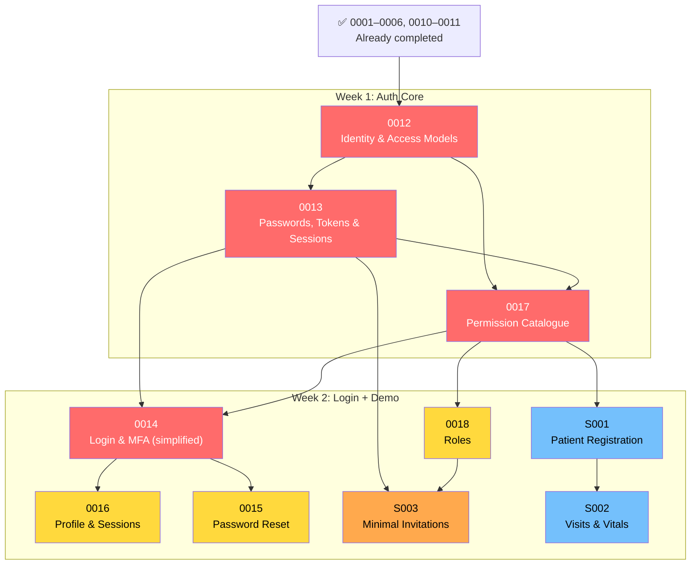

# Sprint Plan — 2-Week MVP Backend (Nov 13–27, 2026)

| | |
| :-- | :-- |
| Duration | 10 working days |
| Goal | Demoable end-to-end flow: **Login → Register patient → Create visit → Record vitals → Close visit** |
| Branch | `feat/sprint-mvp` (from `feat/tenants-config`) |

## What's Already Done

| # | Ticket | Milestone | Status |
| :-- | :-- | :-- | :-- |
| 0001 | CI pipeline | M0 | ✅ Done |
| 0002 | Local infrastructure | M0 | ✅ Done |
| 0003 | Migrations and indexes | M0 | ✅ Done |
| 0004 | Repository primitives | M0 | ✅ Done |
| 0005 | Transactional outbox | M0 | ✅ Done |
| 0006 | HTTP hardening and rate limits | M0 | ✅ Done |
| 0010 | Tenant records and seeding | M1 | ✅ Done |
| 0011 | Tenant configuration | M1 | ✅ Done |

---

## Sprint Scope

### 🔴 Tier 1 — Auth Core (Must Have)

Without these, no user can authenticate and no route is protected.

| # | Ticket | Depends On | Est. |
| :-- | :-- | :-- | :-- |
| **0012** | [Identity and access models](0012-identity-and-access-models.md) | 0003, 0004, 0010 | 2 days |
| **0013** | [Passwords, tokens and sessions](0013-passwords-tokens-sessions.md) | 0012 | 2–3 days |
| **0017** | [Permission catalogue and auth deps](0017-permission-catalogue.md) | 0011, 0012, 0013 | 2 days |
| **0014** | [Login and MFA](0014-login-and-mfa.md) *(simplified)* | 0011, 0013, 0017 | 2 days |

### 🟡 Tier 2 — Usability (Strongly Recommended)

Makes the auth system usable beyond seeded accounts.

| # | Ticket | Depends On | Est. |
| :-- | :-- | :-- | :-- |
| **0018** | [Roles endpoints](0018-roles.md) | 0012, 0017 | 1.5 days |
| **0016** | [Profile and session endpoints](0016-profile-and-sessions.md) | 0014, 0017 | 1 day |
| **0015** | [Password reset and change](0015-password-reset-and-change.md) | 0013, 0014 | 1.5 days |

### 🔵 Tier 3 — Patient & Visit Demo (MVP Demo Flow)

Pulled from M2 to enable an end-to-end demo.

| # | Ticket | Depends On | Est. |
| :-- | :-- | :-- | :-- |
| **S001** | [Patient registration (MVP)](sprint/S001-patient-registration.md) | 0017 | 2 days |
| **S002** | [Visits and vitals (MVP)](sprint/S002-visits-and-vitals.md) | S001 | 2 days |

### 🟠 Minimal Addition

| # | Ticket | Depends On | Est. |
| :-- | :-- | :-- | :-- |
| **S003** | [Minimal invitation accept](sprint/S003-minimal-invitations.md) | 0013, 0017, 0018 | 1 day |

---

## Sprint Schedule

```
Week 1 (Nov 13–19): Auth Foundation
├── Day 1–2: 0012 — Identity & access models, repositories, migration
├── Day 3–4: 0013 — Passwords, JWT, sessions, refresh rotation
└── Day 5:   0017 — Permission catalogue, require_permission, get_current_user

Week 2 (Nov 20–26): Login, Patients & Demo Flow
├── Day 6–7: 0014 — Login endpoint, simplified MFA (verify only)
├── Day 7:   0018 — Roles CRUD + 0016 — Profile & sessions
├── Day 8:   0015 — Password reset & change + S003 — Minimal invitations
├── Day 9:   S001 — Patient registration, ID generation, search
└── Day 10:  S002 — Visits, vitals, close visit

Day 11 (Nov 27): Buffer / polish / seed script updates
```

---

## Dependency Graph



---

## Demo Scenario

After the sprint, this end-to-end flow works:

```
1. Admin logs in          →  POST /auth/login (email + password)
2. Gets profile           →  GET /auth/me (permissions, roles, tenant)
3. Registers a patient    →  POST /patients (name, DOB, sex, phone, address)
                              ← Returns patient with auto-generated ID: ACH-48291-2026
4. Creates a visit        →  POST /patients/:id/visits (type, date, clinician, reason)
5. Records vitals         →  POST /visits/:id/vitals (temp, pulse, BP, weight, height)
                              ← Server computes BMI, validates ranges
6. Views patient chart    →  GET /patients/:id (summary with visits, vitals)
7. Closes the visit       →  POST /visits/:id/close
8. Searches patients      →  GET /patients?status=active&sort=-registration_date
```

---

## Sprint Simplifications

These scope reductions keep us within budget:

| Area | Full Plan | Sprint MVP |
| :-- | :-- | :-- |
| **MFA** | Full enrollment, recovery codes, disable | Verify + challenge only; seed accounts MFA-disabled |
| **Invitations** | Email reservation, outbox delivery, acceptance flow | Token-based accept, no email; admin shares link manually |
| **Patient search** | Fuzzy name search, phonetic matching, duplicate detection | Basic filters (status, date range); duplicate check deferred |
| **Patient merge** | Merge workflow with field choices, number resolution | Deferred entirely |
| **Clinical entries** | Versioned notes, draft/sign workflow, prescriptions | Deferred to post-sprint |
| **Care-team scoping** | PolicyService, per-patient access control | All authenticated staff can access patients (`patient:read` permission) |
| **Vitals trends** | Trend aggregation endpoint | Deferred; basic vitals recording only |
| **Audit** | Formal audit log with atomic seq, query endpoint | JSON structured logs only; formal audit deferred |
| **Isolation suite** | CI merge gate with cross-tenant penetration tests | Existing guard + unit tests; formal suite deferred |
| **Staff management** | Full admin CRUD, deactivate, remove, MFA reset | Deferred; use seed script for user management |

---

## Deferred to Post-Sprint

These tickets are important but not launch-blocking for the MVP demo:

| # | Ticket | Effort | Priority |
| :-- | :-- | :-- | :-- |
| 0019 | Invitations (full, with email) | 2–3 days | High (first post-sprint) |
| 0020 | Staff management | 2–3 days | High |
| 0021 | Audit core | 2 days | Medium |
| 0022 | Isolation test suite | 2 days | Medium |
| — | Patient duplicate detection | 1 day | Medium |
| — | Clinical entries (notes, prescriptions) | 3–4 days | High |
| — | Document capture | 3–4 days | Medium |

---

## Risk Mitigation

| Risk | Impact | Mitigation |
| :-- | :-- | :-- |
| Auth tickets take longer than estimated | Blocks everything in Week 2 | Start 0012 + 0013 in parallel where possible; 0012 is pure models with no service logic |
| Patient/visit tickets need auth to be done | No demo without login | Can test patient endpoints with bearer-token bypass in development while auth finishes |
| Seed script doesn't cover enough scenarios | Thin demo | Extend `scripts/seed.py` with patients, visits, and vitals data at the end |
| MFA simplification leaves gaps | Security concern at review | Document it as a known deferral; MFA enrollment is not demo-blocking |

